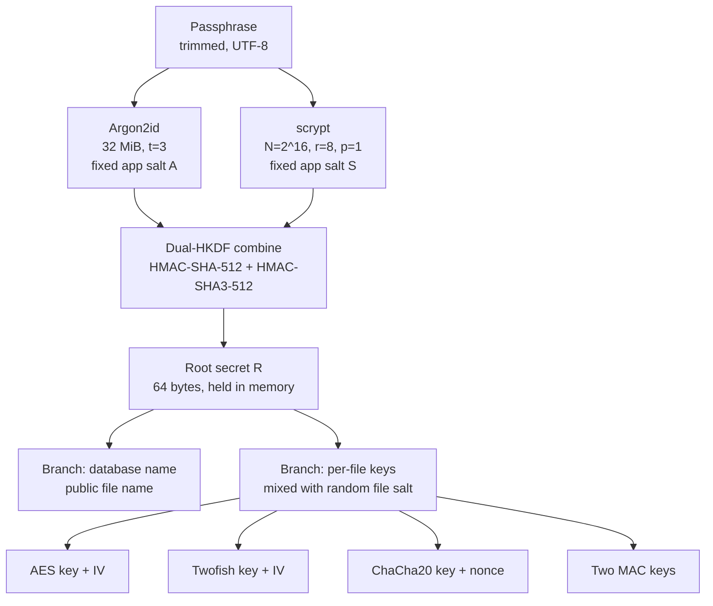
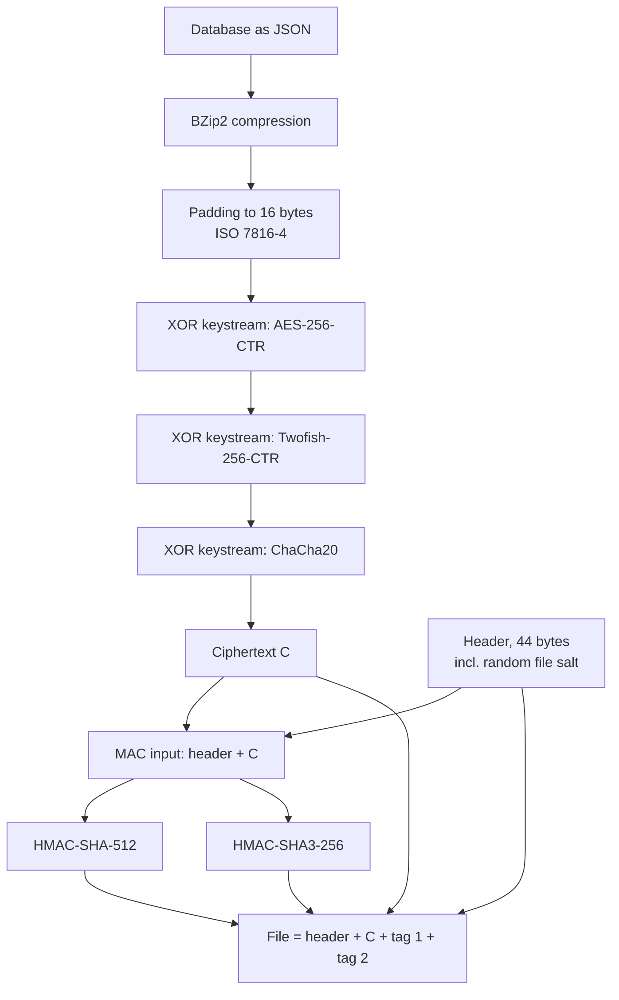
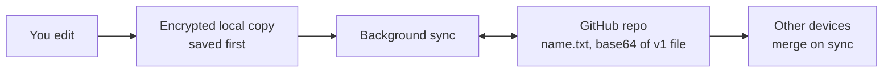

# Ultracipher security design

> **Status.** Encryption format **v1** is implemented, from app version 2.0.51 on. This document describes what the code does (`ultracipher_flutter/lib/src/crypto/`, `db_codec.dart`, `user_key_hash.dart`). Databases written by earlier app versions use a different format that the app no longer reads; they move over as CSV (see [File format v1](#5-file-format-v1)).
>
> **Not audited.** Neither the design nor the implementation has had an independent security audit. The cryptographic primitives come from a pure-Dart library (`pointycastle`) that is not formally audited either. Treat this document as an explanation of intent, not as a guarantee.

Ultracipher is an end-to-end encrypted database for passwords and notes. Everything is encrypted on your device with a key derived from your passphrase. The encrypted file is stored in a GitHub repository that you choose.

## Contents

1. [Design goals](#1-design-goals)
2. [Threat model](#2-threat-model)
3. [Key derivation](#3-key-derivation)
4. [Encryption layers](#4-encryption-layers)
5. [File format v1](#5-file-format-v1)
6. [Storage and sync](#6-storage-and-sync)
7. [Post-quantum notes](#7-post-quantum-notes)
8. [Trust and builds](#8-trust-and-builds)
9. [Libraries and testing](#9-libraries-and-testing)

---

## 1. Design goals

| Goal | What it means |
|---|---|
| End-to-end encryption | Plaintext and keys exist only on your devices. GitHub only ever sees ciphertext. |
| No server of our own | There is no Ultracipher backend. Your own GitHub repository is the storage. Nobody operates infrastructure that could be breached or shut down. |
| Local-first | The app works on a local encrypted copy. Changes are saved locally first and synced in the background. No network, no problem. |
| No single algorithm | Defence in depth: several independent ciphers, two independent hash families and two independent key-derivation functions. Breaking one of them is not enough. |
| Simple to explain | Few moving parts, one place where primitives are combined, fixed allow-lists instead of negotiable parameters. |

---

## 2. Threat model

In plain words.

**Protected**

| Situation | Why it holds |
|---|---|
| Someone reads your GitHub repository (public repo, leaked token, GitHub employee, backup) | The file is ciphertext. Without the passphrase there is nothing to read. Even the file name reveals nothing about the passphrase. |
| Someone records or tampers with traffic | The payload is encrypted and authenticated before it leaves the app; tampering is detected. TLS adds a second layer. |
| Lost or stolen device, **without** the passphrase | The local copy is the same encrypted file. |
| Modified or corrupted file | Two independent MACs are verified before anything is decrypted. |

**Not protected**

| Situation | Why |
|---|---|
| Compromised device or OS while the database is unlocked | Decrypted data and keys are in memory. Malware, keyloggers and screen capture win. |
| Weak or reused passphrases | The passphrase is the only secret. The key derivation makes every guess expensive, but cannot rescue `password123`. |
| A malicious build of the app | The app handles your plaintext. See [Trust and builds](#8-trust-and-builds). |
| Metadata | The file size (to 16-byte precision), the number and timing of commits, and the repository itself are visible to whoever can see the repository. |
| Old versions already pushed | Git keeps history. See [Storage and sync](#6-storage-and-sync). |
| Side channels | The pure-Dart AES and Twofish implementations are table-based and not constant-time. This is a low risk for a local app, but not zero. |

---

## 3. Key derivation

The passphrase is stretched with **two different memory-hard functions in parallel**, so the result stays safe if either one is ever weakened. Their outputs are combined with a hash-based KDF that itself uses two hash families.



### The steps

| Step | Detail |
|---|---|
| Input | `utf8(passphrase.trim())`. No Unicode normalisation; the app warns about non-ASCII characters when you set a passphrase. |
| Argon2id | Version 0x13, memory 32 MiB, 3 passes, 1 lane, fixed domain-separated salt (`ultracipher/kdf/1/argon2id`). |
| scrypt | N = 2^16, r = 8, p = 1, 64-byte output, fixed domain-separated salt (`ultracipher/kdf/1/scrypt`). |
| Combine | Both outputs (Argon2id first) are concatenated and fed through **Dual-HKDF** with its own salt (`ultracipher/kdf/1/combine`), producing the 64-byte root secret **R**. |
| Branches | Separate HKDF branches derive the database name (salt `ultracipher/name`) and the per-file keys (salt = the random file salt, labels `ultracipher/file/...`). Nothing derived for one purpose is ever used for another. |

The KDF parameters live only in the app, never in a file; a different parameter set would be a new profile with new salts. On native platforms the two KDFs run at the same time in two isolates, so the wait is the slower of the two rather than the sum. In a web browser everything runs on the main thread: the two run one after the other and the page does not respond meanwhile (the app shows a progress hint). One KDF profile is used on **all** platforms: the database name depends on the result, so every device that opens the same database must derive exactly the same value. This costs roughly 0.5 s natively and about 12 s in a web browser (see [Libraries and testing](#9-libraries-and-testing)).

R is derived when you open, create or import a database, remove one with its passphrase, and twice when you change the passphrase. Saving, syncing, exporting and setting up GitHub only derive the cheap per-file keys from the R held in memory. The passphrase is not kept, and **no key or password check is cached on disk**: R lives in memory while a database is open and is dropped when it is closed.

### Dual-HKDF

A small combiner used wherever keys are derived:

```
DualExtract(salt, ikm)      = ( HMAC-SHA-512(salt, ikm),  HMAC-SHA3-512(salt, ikm) )
DualExpand(P1, P2, info, L) = HKDF-Expand-SHA-512(P1, info, L)  XOR  HKDF-Expand-SHA3-512(P2, info, L)
```

If either hash family still behaves as a pseudorandom function, so does the result. This is a heuristic composition of two standard HKDFs, **not** a standardised construction and not formally proven. It lives in a single source file with its own test vectors so that it can be reviewed in one place.

### Why there is no cheap shortcut

The database name is public: it is the name of the file in your repository. It is safe to publish because:

- **It cannot be inverted.** The name is a 256-bit output of the dual HKDF over the 512-bit secret R. Recovering R or any file key from it would be a preimage search on that function: infeasible regardless of passphrase strength.
- **Every guess costs the full cascade.** The name derives only from R, and R derives only from *both* KDF outputs. There is no intermediate value, verifier, hash or cache entry from which the name (or a "password correct" check) can be computed more cheaply. An attacker who wants to test a passphrase against a public file name must run Argon2id **and** scrypt for every single guess.
- **Keys are separated.** Name, cipher keys and MAC keys come from different HKDF branches, so the name reveals nothing about the other keys.

The app deliberately keeps no cheap password check anywhere. Intermediate values are never stored or logged.

### The accepted trade-off

> The app salts for the expensive KDF stage are **fixed and versioned**, not random per database.

This is a conscious choice: with a per-database salt, the app could not find your database by passphrase alone (the name would need the salt, which would have to be stored somewhere readable). The consequence is honest and simple: an attacker can do **one precomputation for all users of the app** (run a dictionary through the KDF cascade once) and compare the results against the public file names in many repositories. This multi-target attack is mitigated only by the cost of the KDF cascade per guess and by the strength of your passphrase. The built-in passphrase generator produces 16 characters from an 81-symbol set (about 101 bits). Use a long, random passphrase.

The per-file random salt (next section) is mixed in only *after* the expensive stage; it protects the file keys, not the name.

---

## 4. Encryption layers



### Pipeline

1. **Serialise** the database to JSON (UTF-8), then **compress** with BZip2. The constant 4-byte BZip2 stream header (`BZh9`) is dropped before encryption and added back when reading; there is no TAR container.
2. **Pad** to a multiple of 16 bytes (ISO/IEC 7816-4: byte `0x80`, then zeros; always at least one byte). The file size therefore reveals the compressed size to 16-byte precision, and nothing coarser is hidden on purpose. The padding is removed only after the MACs have verified, so there is no padding oracle.
3. **Encrypt three times** with independent keys: AES-256 in CTR mode, Twofish-256 in CTR mode, ChaCha20 (RFC 8439).
4. **Authenticate** header and ciphertext with two MACs from different hash families (encrypt-then-MAC).

### Why three stream layers

All three layers are stream ciphers (CTR turns a block cipher into one). Each produces a keystream, and the layers are combined by XOR:

```
C = plaintext  XOR  keystream_AES  XOR  keystream_Twofish  XOR  keystream_ChaCha20
```

- **Independent keys.** Every key and IV is derived with its own HKDF label, and the first 12 header bytes (magic, version, suite, KDF profile, flags) are part of every label, so another suite or version yields other keys. No key is ever used twice.
- **No intermediate headers or structure.** There is nothing between the layers to test against. If an attacker somehow broke one layer and removed its keystream, what remains is still masked by the other two and looks like random data. There is no way to confirm that a single layer was "cracked".
- **Confidentiality holds as long as at least one of the three ciphers is unbroken.** A secure keystream hides the plaintext like a one-time pad, even from someone who knows the other two keystreams.
- **Three different designs.** AES is a substitution-permutation network, Twofish a Feistel network with key-dependent S-boxes, ChaCha20 is built from add-rotate-xor (ARX) operations. Different structure means different cryptanalytic attack surface.
- **CTR for Twofish** keeps the mode the same as for AES and only needs the *encryption* direction of the block cipher, which limits exposure to implementation bugs in a young code path.

### Authentication: two MACs, two hash families

| Tag | Algorithm | Size |
|---|---|---|
| Tag 1 | HMAC-SHA-512 | 64 bytes |
| Tag 2 | HMAC-SHA3-256 | 32 bytes |

Both cover the **entire header plus ciphertext** and use separate 64-byte keys.

- **SHA-2 and SHA-3 are different families.** SHA-2 is a Merkle–Damgård construction (iterated compression function); SHA-3 is a sponge (Keccak permutation). They share no internal structure, so a structural weakness in one is not expected to carry over to the other.
- **Integrity holds as long as at least one MAC family holds**, because a forgery must pass both checks.
- **Verification order on read:** check length and header allow-lists, derive the keys, compute **both** tags, compare each in constant time (no early return), combine the results, and only if both are valid decrypt, unpad, decompress and parse. The error is neutral ("wrong passphrase or damaged") and never says which check failed, and the same error covers bad padding after a valid tag.
- **Key commitment.** A valid tag binds the file to exactly one MAC key and therefore to one passphrase. Attacks that exploit AEAD modes which can verify under two different keys (partitioning-oracle attacks) do not apply.

### Fresh keys for every save

Each save draws a new 32-byte **file salt** from the operating system's secure random generator. The per-file keys and nonces are derived from R and this salt, so **every save uses entirely new keys, IVs and nonces**, across all three layers. A repeated salt would repeat the keystream, which is why the salt is always freshly random and never derived from time or a counter.

---

## 5. File format v1

All integers are big-endian. The file is stored as one line of base64 text.

| Offset | Size | Field | Value / rule |
|---:|---:|---|---|
| 0 | 4 | magic | ASCII `UCDB` |
| 4 | 2 | format version | `0x0001` |
| 6 | 2 | suite id | `0x0001` = AES-256-CTR + Twofish-256-CTR + ChaCha20, HMAC-SHA-512 + HMAC-SHA3-256, Dual-HKDF, JSON then BZip2, ISO 7816-4 padding to 16 |
| 8 | 2 | KDF profile | `0x0001` (parameters live in the app, not in the file) |
| 10 | 2 | flags | `0x0000`; any set bit is rejected as "newer version" |
| 12 | 32 | file salt | fresh random value per save |
| 44 | n | ciphertext | `n >= 16`, `n` a multiple of 16 |
| 44 + n | 64 | tag 1 | HMAC-SHA-512 over bytes `0 .. 44+n` |
| 108 + n | 32 | tag 2 | HMAC-SHA3-256 over bytes `0 .. 44+n` |

Total length is `140 + n` bytes (minimum 156). Because the version is inside the MAC input, the authenticated region is unambiguous.

### Reading safely

- **KDF parameters never come from the file.** The root secret R is derived before the file is read, using the app's own profile table. The file's profile field must match it. A hostile file cannot request enormous parameters.
- **Allow-lists, not ranges:** only known versions, suites, KDF profiles and flags are accepted. An unknown version, suite or flag yields "written by a newer app version, please update"; an unknown KDF profile asks for an app update as well. The app never guesses.
- **Old formats** are recognised by the magic: anything that does not start with `UCDB` is reported as an older format, with the hint to export a CSV in the old app and import it. This check needs no key derivation and does not depend on the passphrase. Old local copies are hidden from the database list (they cannot be opened) and the start screen points to the CSV route; "Erase local data" can remove them in a second, separate step.
- **Size limits:** files above 64 MiB and base64 text longer than what such a file needs are rejected before any cryptography or decoding runs.
- **Decompression only after both MACs verify**, so a decompression bomb needs the key. A further cap of 512 MiB on the decompressed size applies even to a validly signed file.

### Versioning and crypto agility

- **Readers accept every known version** (each version's parser is kept forever). **The writer always writes the newest.**
- New formats roll out in two stages: first an app release that can *read* the new format, later one that *writes* it. Otherwise a device with a new app would lock out devices with an old one.
- A new cipher, MAC, codec or header layout is a new suite or format version. The database name and root secret stay the same and the file is rewritten in the new format on the next save.
- KDF parameters are the exception: they determine R and thus the name, so a new KDF profile means new names and a one-time move of each database. Such changes are intended to be rare.
- **Planned upgrade rule for future versions:** load with the old passphrase and the old algorithm, save with the same passphrase and the new algorithm, then **recommend changing the passphrase**. Older versions stay in Git history and remain attackable with the old algorithm; only a new passphrase makes them worthless.
- v1 is the first version of this format; files from the earlier, pre-v1 format are not read (legacy data comes in via CSV import).

---

## 6. Storage and sync



- **Local first.** Every change is encrypted and saved on the device immediately. Sync runs afterwards and never blocks or fails a save. Offline use just works.
- **One database per passphrase.** The database name is derived from the passphrase (see above). Opening with a wrong passphrase finds no database; the message is deliberately neutral.
- **GitHub file.** The v1 file is stored in your repository as `<name>.txt`, one line of base64. The app talks to the GitHub Contents API with your token; there is no other server. The branch is optional: left empty, the repository's default branch is used (whether it is called `main` or `master`).
- **Merging.** Sync reads the remote file, merges it with the local data, writes back if anything differs, and retries on conflicts. Divergent edits from several devices are merged rather than overwritten.
- **Settings live inside the database.** This includes the GitHub token, so it is encrypted together with your data and travels to your other devices through the same file. It is not stored in plaintext in the repository. CSV export never contains the settings; the encrypted export does (token included).
- **History.** Git keeps every earlier version of `<name>.txt`. This is accepted, with an important consequence: **changing your passphrase does not protect versions already pushed.** Old commits stay encrypted under the old passphrase and algorithms. If that passphrase was weak or later leaked, those versions are exposed. Treat a compromised passphrase as a compromise of everything that was ever pushed under it.
- **Changing the passphrase** creates a new database name: the app writes the new file, then deletes the old file in the repository and the old local copy.
- **Hung requests.** Every GitHub request is aborted after a timeout (30 s); an unreachable server shows up as "not synced" instead of blocking the app.
- **Stolen token.** A leaked GitHub token gives access to the repository (reading, overwriting or deleting the ciphertext), not to the plaintext. Use a fine-grained token limited to the one repository and the contents permission.

---

## 7. Post-quantum notes

- **There is no public-key cryptography in the data path.** No RSA, no elliptic curves, no key exchange. The things that quantum computers are expected to break (Shor's algorithm) are simply not used for your data.
- **Symmetric keys are 256-bit** (AES-256, Twofish-256, ChaCha20). Grover's algorithm roughly halves the effective strength, leaving about 128 bits, which is considered sufficient.
- **Hashes and MACs** use 256- to 512-bit outputs; the same square-root reasoning applies.
- **The only asymmetric part is TLS** between the app and GitHub. "Harvest now, decrypt later" against that traffic yields only the already encrypted file and the GitHub token.
- Long-term protection therefore rests on passphrase entropy, the KDF cost, and 256-bit symmetric ciphers.

---

## 8. Trust and builds

The cryptography is only as trustworthy as the code that runs it. A modified app can read your passphrase and your plaintext regardless of how good the format is.

- **Native apps** (desktop, mobile) are signed through the platform mechanisms (code signing, app stores). Install them from channels you trust.
- **Web app:** a web page is delivered fresh on every visit, so it is only as trustworthy as the server that delivers it. The recommended way to use Ultracipher in a browser is to **build it yourself from this repository and host it yourself**, for example on your own GitHub Pages. Then you control what code is served. The build runs as WebAssembly in Chromium-based browsers; Firefox, Safari and iOS browsers get the JavaScript build that Flutter falls back to (see [Libraries and testing](#9-libraries-and-testing) for how both are tested).
- The source is open so that builds can be reviewed and reproduced.

---

## 9. Libraries and testing

- **Pure Dart, no native crypto dependency.** All primitives (Argon2id, scrypt, AES, Twofish, ChaCha20, HMAC, SHA-2, SHA-3, HKDF) come from [`pointycastle`](https://pub.dev/packages/pointycastle). The app implements no cipher or hash itself; it only composes them. Twofish is a comparatively young engine in the library, so it is covered by explicit known-answer tests. The BZip2 stage comes from the `archive` package.
- **Known-answer tests.** The primitives are checked against the official published vectors (for example RFC 9106 for Argon2id, RFC 7914 for scrypt, RFC 8439 for ChaCha20, NIST SP 800-38A for AES-CTR, the Twofish paper vectors, RFC 4231 for HMAC-SHA-512, NIST vectors for HMAC-SHA3).
- **Three runtimes.** The primitive tests, the golden vectors and the database-name pins run on the Dart VM, compiled to WebAssembly (`dart2wasm`, in Chrome) **and** compiled to JavaScript (`dart2js`, in Chrome); the web app uses the second in Chromium browsers and the third elsewhere. This matters: `pointycastle` chooses its Argon2 implementation per platform, and the variant that is correct on the VM computes a *different, wrong* result under WebAssembly (measured). Under WebAssembly the library uses the correct but slower variant. The tests exist so that a library upgrade that changes this fails loudly instead of silently deriving a different key, name and "database not found" on one platform.
- **Golden vectors.** A committed, never-regenerated fixture pins the intermediate KDF values, the root secret, the per-file keys and a complete encrypted file for fixed passphrases (ASCII and non-ASCII). A separate test pins the database name for fixed roots. This guards existing user databases against dependency upgrades and refactoring. The vectors were also recomputed independently outside Dart.
- **Rough timings** (Apple M1 Pro, single measurements, so indicative only): key derivation about 0.5 s natively and about 12 s in WebAssembly in a desktop browser (web uses roughly 0.5-1 GB of memory for it, so mobile browsers are not guaranteed to work); encrypting or decrypting and authenticating a 1 MiB payload about 0.6 s natively and 1.4 s in WebAssembly. Real password databases compress to well under a megabyte, so a save costs a few tens of milliseconds.
- **No audit.** Reiterating the status note: the design has not been reviewed by an independent third party, and `pointycastle` has no formal audit. If you find a problem, please open an issue or report it to the maintainer.
